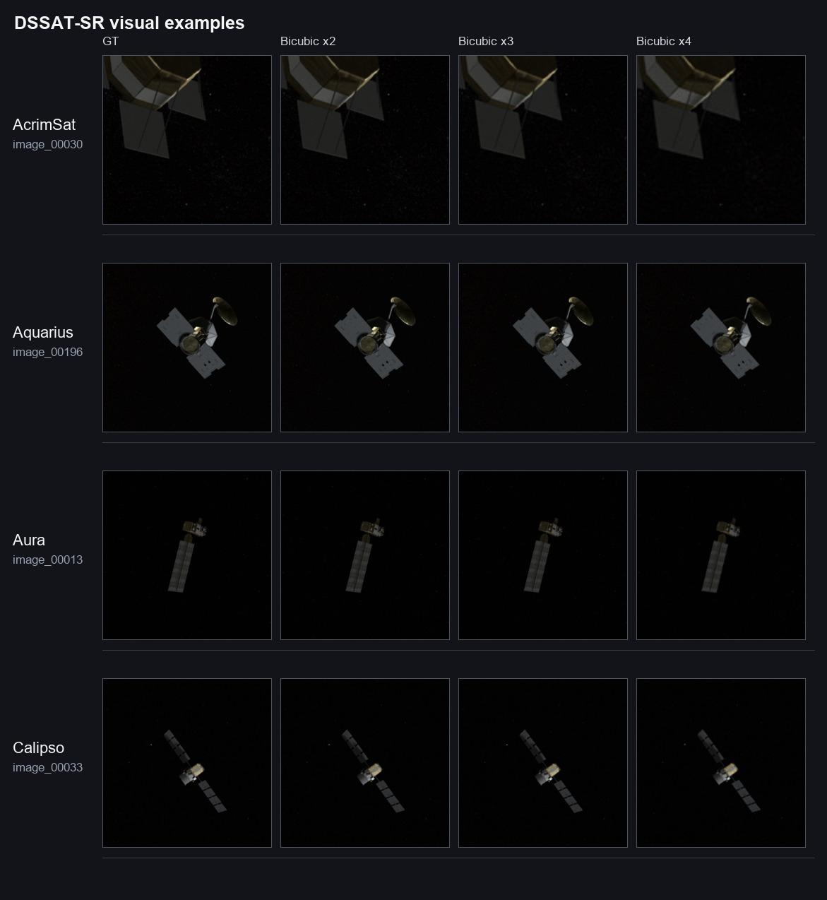
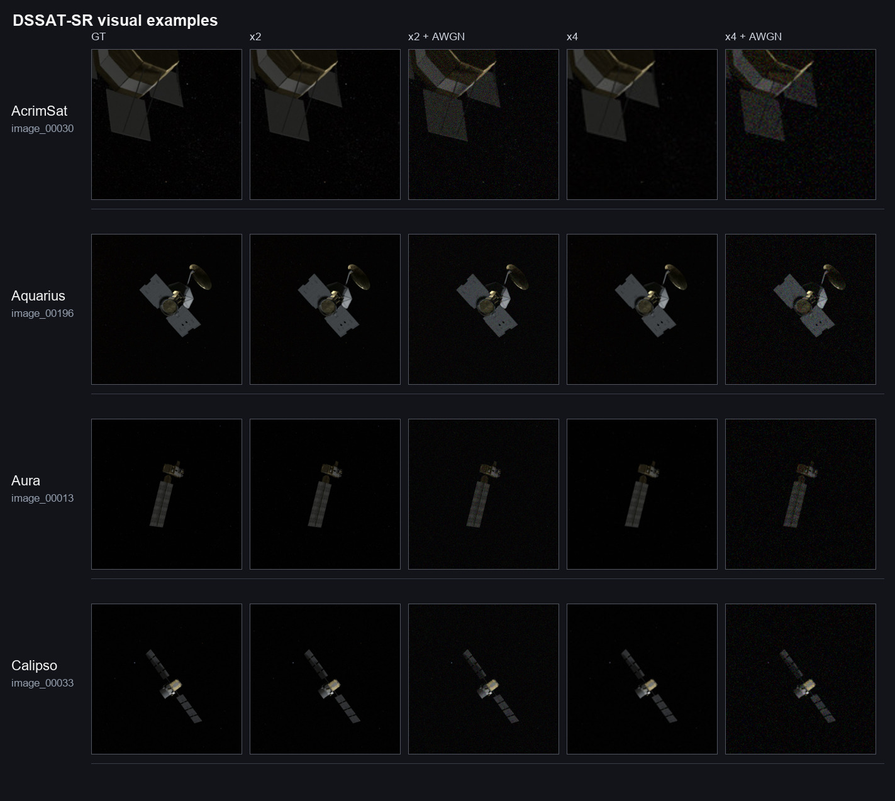

# DSSAT-SR

**DeepSpace Satellite Super-Resolution Dataset**

[中文说明](README_CN.md)

DSSAT-SR is a paired satellite-image super-resolution dataset derived from the
RGB modality of SPARK 2021. It contains 4,240 synthetic images selected
primarily from dark-space and star-field background scenes. Each high-resolution
ground-truth (GT) image is 1024 x 1024 pixels.

This repository provides the dataset description, construction methodology,
statistics, and representative visual examples. The complete dataset is hosted
on Google Drive.

## Download

> **Google Drive:** [Download DSSAT-SR v1.0](https://drive.google.com/file/d/1awbymEqjurDLk52MxE-GjCKDm2iFZ4Fa/view?usp=drivesdk)

Archive: `DSSAT-SR_v1.0.zip` (1,964,961,259 bytes)

SHA-256: `F38E3AC64F01E18BA5B7AC298123D260AA29246FD8DFAE8C241068B1118C04CB`

The downloadable package contains `GT`, `x2`, `x3`, `x4`, `x2_gauss`,
`x3_gauss`, `x4_gauss`, and `mask` for the training, validation, and test
splits.

## Dataset overview

| Split | Images | Proportion |
|---|---:|---:|
| Train | 2,968 | 70% |
| Validation | 848 | 20% |
| Test | 424 | 10% |
| **Total** | **4,240** | **100%** |

The nine retained satellite classes are:

| Prefix | Class | Images |
|---|---|---:|
| A | AcrimSat | 475 |
| B | Aquarius | 324 |
| C | Aura | 803 |
| D | Calipso | 544 |
| E | CloudSat | 429 |
| F | Jason | 576 |
| G | Sentinel-6 | 411 |
| H | Terra | 485 |
| I | TRMM | 193 |

The generic CubeSat and Debris classes in SPARK 2021 are not included.

## Construction methodology

For a ground-truth image \(I_{GT}\), the noise-free low-resolution image at
scale \(s\) is generated by bicubic downsampling:

```text
I_LR^s = Bicubic(I_GT, 1/s),  s in {2, 3, 4}.
```

The noisy version is generated by adding independent zero-mean white Gaussian
noise to the RGB channels after bicubic downsampling:

```text
I_LR,Gauss^s = clip(Bicubic(I_GT, 1/s) + n, 0, 255),
n ~ N(0, 10^2).
```

The Gaussian-noise standard deviation is 10 in the 0-255 pixel range. The
output resolutions are 512 x 512 for x2, 341 x 341 for x3, and 256 x 256 for
x4. Files belonging to the same sample retain the same base filename across all
directories.

The supplied masks are 1024 x 1024 single-channel binary PNG images, where 0
denotes the background and 255 denotes the satellite foreground.

## Visual examples

### Bicubic degradation at different scales



### Bicubic and Gaussian-noise degradation



## Intended use

DSSAT-SR is intended for supervised satellite-image super-resolution,
multi-scale evaluation, Gaussian-noise robustness studies, and
foreground-aware reconstruction using the accompanying masks.

The source imagery is synthetic. Performance measured on DSSAT-SR should not be
interpreted as direct evidence of performance on real on-orbit imagery without
additional domain validation.

## Source and license

DSSAT-SR is derived from the SPARK 2021 dataset. The dataset and the preview
images in this repository are distributed under the Creative Commons
Attribution-NonCommercial-ShareAlike 4.0 International license
(CC BY-NC-SA 4.0). Users must also comply with the terms of the original SPARK
2021 release.

Original project: https://cvi2.uni.lu/spark-2021/

## Citation

Please cite the original SPARK 2021 publication when using DSSAT-SR:

```bibtex
@inproceedings{musallam2021spark,
  title     = {Spacecraft Recognition Leveraging Knowledge of Space Environment:
               Simulator, Dataset, Competition Design and Analysis},
  author    = {Musallam, Mohamed Adel and Gaudilliere, Vincent and Ghorbel, Enjie
               and Al Ismaeil, Kassem and Perez, Marcos Damian and Poucet, Michel
               and Aouada, Djamila},
  booktitle = {2021 IEEE International Conference on Image Processing Challenges},
  pages     = {11--15},
  year      = {2021},
  doi       = {10.1109/ICIPC53495.2021.9620184}
}
```
