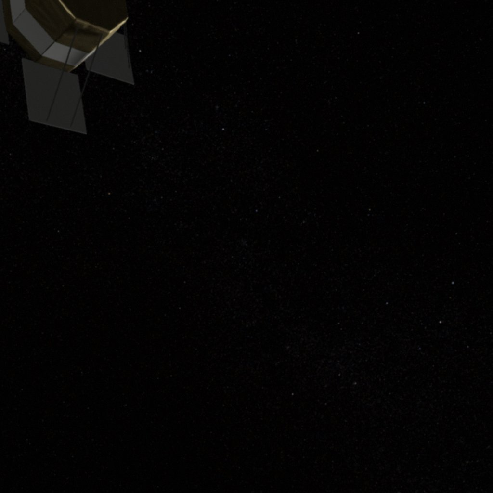
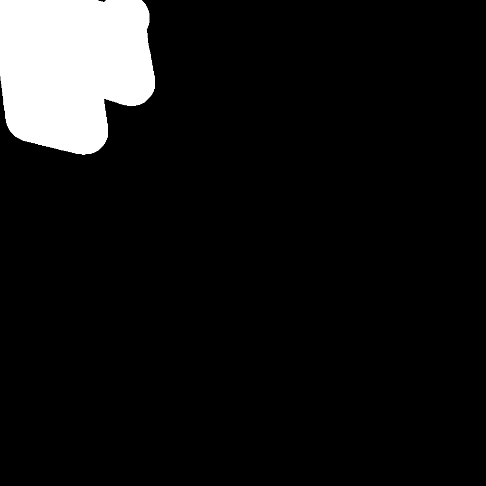
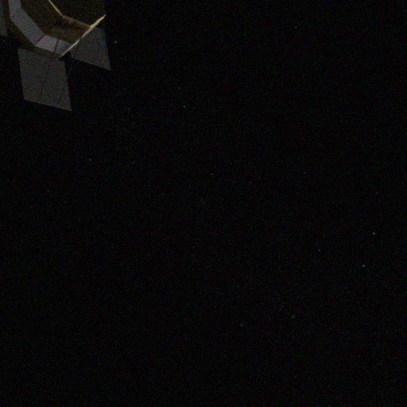
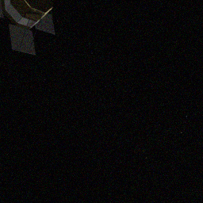
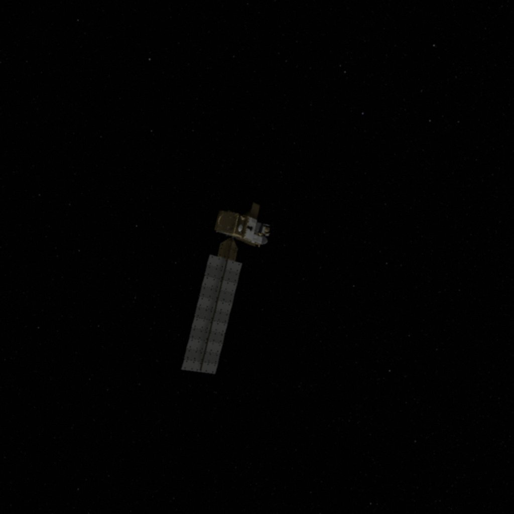
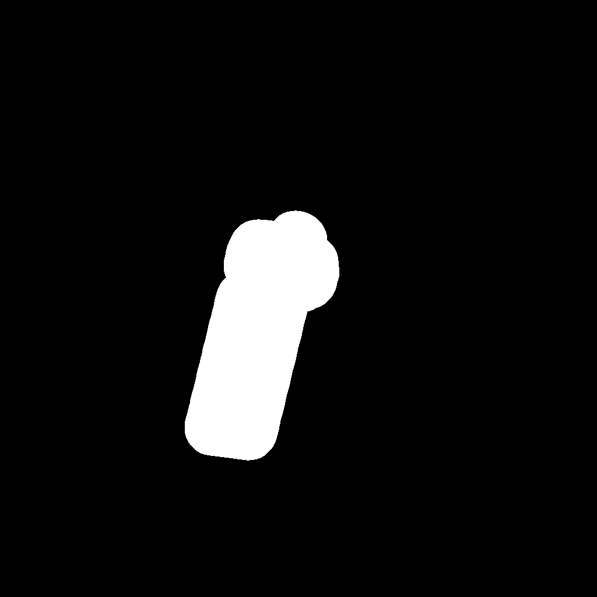
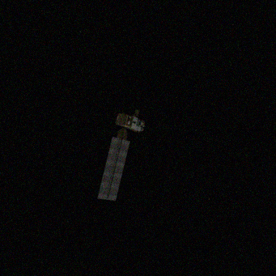

# DSSAT-SR

**DeepSpace Satellite Super-Resolution Dataset**

[中文说明](README_CN.md)

DSSAT-SR is a paired satellite-image super-resolution dataset derived from the
RGB modality of SPARK 2021. It contains 4,240 synthetic images selected
primarily from dark-space and star-field background scenes. Each high-resolution
ground-truth (GT) image is 1024 x 1024 pixels.

This repository provides the dataset description, construction methodology,
statistics, and representative visual examples. The complete dataset is hosted
on Google Drive.

## Download

> **Google Drive:** [Download DSSAT-SR v1.0](https://drive.google.com/file/d/1awbymEqjurDLk52MxE-GjCKDm2iFZ4Fa/view?usp=drivesdk)

Archive: `DSSAT-SR_v1.0.zip` (1,964,961,259 bytes)

The downloadable package contains `GT`, `x2`, `x3`, `x4`, `x2_gauss`,
`x3_gauss`, `x4_gauss`, and `mask` for the training, validation, and test
splits.

## Dataset overview

| Split | Images | Proportion |
|---|---:|---:|
| Train | 2,968 | 70% |
| Validation | 848 | 20% |
| Test | 424 | 10% |
| **Total** | **4,240** | **100%** |

## Construction methodology

For a ground-truth image \(I_{GT}\), the noise-free low-resolution image at
scale \(s\) is generated by bicubic downsampling:

```text
I_LR^s = Bicubic(I_GT, 1/s),  s in {2, 3, 4}.
```

The noisy version is generated by adding independent zero-mean white Gaussian
noise to the RGB channels after bicubic downsampling:

```text
I_LR,Gauss^s = clip(Bicubic(I_GT, 1/s) + n, 0, 255),
n ~ N(0, 10^2).
```

The Gaussian-noise standard deviation is 10 in the 0-255 pixel range. The
output resolutions are 512 x 512 for x2, 341 x 341 for x3, and 256 x 256 for
x4. Files belonging to the same sample retain the same base filename across all
directories.

The supplied masks are 1024 x 1024 single-channel binary PNG images, where 0
denotes the background and 255 denotes the satellite foreground.

## Visual examples

Click any image to inspect it at its native resolution. All images within a
sample use the same base filename.

### Sample A — `A_2image_00030_img`

<table>
  <tr>
    <td align="center" width="25%"><strong>GT</strong><br><sub>1024 x 1024</sub><br><a href="assets/examples/A_2image_00030_img/GT/A_2image_00030_img.jpg"></a></td>
    <td align="center" width="25%"><strong>x2</strong><br><sub>Bicubic · 512 x 512</sub><br><a href="assets/examples/A_2image_00030_img/x2/A_2image_00030_img.jpg"></a></td>
    <td align="center" width="25%"><strong>x3</strong><br><sub>Bicubic · 341 x 341</sub><br><a href="assets/examples/A_2image_00030_img/x3/A_2image_00030_img.jpg"></a></td>
    <td align="center" width="25%"><strong>x4</strong><br><sub>Bicubic · 256 x 256</sub><br><a href="assets/examples/A_2image_00030_img/x4/A_2image_00030_img.jpg"></a></td>
  </tr>
  <tr>
    <td align="center"><strong>Mask</strong><br><sub>1024 x 1024</sub><br><a href="assets/examples/A_2image_00030_img/mask/A_2image_00030_img.png"></a></td>
    <td align="center"><strong>x2_gauss</strong><br><sub>Bicubic + AWGN · 512 x 512 · &sigma; = 10</sub><br><a href="assets/examples/A_2image_00030_img/x2_gauss/A_2image_00030_img.jpg"></a></td>
    <td align="center"><strong>x3_gauss</strong><br><sub>Bicubic + AWGN · 341 x 341 · &sigma; = 10</sub><br><a href="assets/examples/A_2image_00030_img/x3_gauss/A_2image_00030_img.jpg"></a></td>
    <td align="center"><strong>x4_gauss</strong><br><sub>Bicubic + AWGN · 256 x 256 · &sigma; = 10</sub><br><a href="assets/examples/A_2image_00030_img/x4_gauss/A_2image_00030_img.jpg"></a></td>
  </tr>
</table>

### Sample C — `C_2image_00013_img`

<table>
  <tr>
    <td align="center" width="25%"><strong>GT</strong><br><sub>1024 x 1024</sub><br><a href="assets/examples/C_2image_00013_img/GT/C_2image_00013_img.jpg"></a></td>
    <td align="center" width="25%"><strong>x2</strong><br><sub>Bicubic · 512 x 512</sub><br><a href="assets/examples/C_2image_00013_img/x2/C_2image_00013_img.jpg"></a></td>
    <td align="center" width="25%"><strong>x3</strong><br><sub>Bicubic · 341 x 341</sub><br><a href="assets/examples/C_2image_00013_img/x3/C_2image_00013_img.jpg"></a></td>
    <td align="center" width="25%"><strong>x4</strong><br><sub>Bicubic · 256 x 256</sub><br><a href="assets/examples/C_2image_00013_img/x4/C_2image_00013_img.jpg"></a></td>
  </tr>
  <tr>
    <td align="center"><strong>Mask</strong><br><sub>1024 x 1024</sub><br><a href="assets/examples/C_2image_00013_img/mask/C_2image_00013_img.png"></a></td>
    <td align="center"><strong>x2_gauss</strong><br><sub>Bicubic + AWGN · 512 x 512 · &sigma; = 10</sub><br><a href="assets/examples/C_2image_00013_img/x2_gauss/C_2image_00013_img.jpg"></a></td>
    <td align="center"><strong>x3_gauss</strong><br><sub>Bicubic + AWGN · 341 x 341 · &sigma; = 10</sub><br><a href="assets/examples/C_2image_00013_img/x3_gauss/C_2image_00013_img.jpg"></a></td>
    <td align="center"><strong>x4_gauss</strong><br><sub>Bicubic + AWGN · 256 x 256 · &sigma; = 10</sub><br><a href="assets/examples/C_2image_00013_img/x4_gauss/C_2image_00013_img.jpg"></a></td>
  </tr>
</table>

## Intended use

DSSAT-SR is intended for supervised satellite-image super-resolution,
multi-scale evaluation, Gaussian-noise robustness studies, and
foreground-aware reconstruction using the accompanying masks.

The source imagery is synthetic. Performance measured on DSSAT-SR should not be
interpreted as direct evidence of performance on real on-orbit imagery without
additional domain validation.

## Source, license, and citation

DSSAT-SR is derived from the SPARK 2021 dataset. The dataset and the preview
images in this repository are distributed under the Creative Commons
Attribution-NonCommercial-ShareAlike 4.0 International license
(CC BY-NC-SA 4.0). Users must also comply with the terms of the original SPARK
2021 release.

Original project: https://cvi2.uni.lu/spark-2021/

### Citation

DSSAT-SR redistributes and transforms imagery from SPARK 2021. For academic
use, citing the original SPARK 2021 publication provides appropriate source
attribution and keeps the provenance of the derived dataset traceable.

```bibtex
@inproceedings{musallam2021spark,
  title     = {Spacecraft Recognition Leveraging Knowledge of Space Environment:
               Simulator, Dataset, Competition Design and Analysis},
  author    = {Musallam, Mohamed Adel and Gaudilliere, Vincent and Ghorbel, Enjie
               and Al Ismaeil, Kassem and Perez, Marcos Damian and Poucet, Michel
               and Aouada, Djamila},
  booktitle = {2021 IEEE International Conference on Image Processing Challenges},
  pages     = {11--15},
  year      = {2021},
  doi       = {10.1109/ICIPC53495.2021.9620184}
}
```

### Acknowledgment

We thank the CVI2 research group at the University of Luxembourg and its
collaborators for creating and releasing the SPARK 2021 dataset.
