# DSSAT-SR 数据集

**DeepSpace Satellite Super-Resolution Dataset（深空卫星图像超分辨率数据集）**

DSSAT-SR 基于 SPARK 2021 数据集的 RGB 图像构建，共包含 4,240 幅以深空
星空为主要背景的合成卫星图像。所有高分辨率真值图像（GT）的空间分辨率均为
1024 x 1024。

本 GitHub 仓库用于公开数据集的构建原理、统计信息、使用说明和代表性效果图；
完整数据通过 Google 云盘提供下载。

## 数据下载

> **Google 云盘：** [下载 DSSAT-SR v1.1](https://drive.google.com/file/d/1DUetEH4QD9XD1MqPgsk6swSGO4NA2Y62/view?usp=drivesdk)

压缩包：`DSSAT-SR_v1.1.zip`（1,921,228,827 字节）

训练集、验证集和测试集均提供 `GT`、`x2`、`x3`、`x4`、`x2_gauss`、
`x3_gauss` 和 `x4_gauss`。二值掩膜分别存放于 `Masks/train`、
`Masks/val` 和 `Masks/test`。

## 数据划分

| 子集 | 图像数量 | 比例 |
|---|---:|---:|
| 训练集 | 2,968 | 70% |
| 验证集 | 848 | 20% |
| 测试集 | 424 | 10% |
| **合计** | **4,240** | **100%** |

## 数据集制作原理

对于高分辨率真值图像 \(I_{GT}\)，采用双三次插值构建尺度因子为
\(s\) 的无噪声低分辨率图像：

```text
I_LR^s = Bicubic(I_GT, 1/s),  s in {2, 3, 4}。
```

在双三次下采样结果中加入RGB三通道相互独立的零均值白高斯噪声，构建含噪
低分辨率图像：

```text
I_LR,Gauss^s = clip(Bicubic(I_GT, 1/s) + n, 0, 255)，
n ~ N(0, 10^2)。
```

其中，高斯噪声在 0-255 像素范围内的标准差为 10，`clip` 操作用于将像素值
限制在 8 位图像的有效范围内。x2、x3 和 x4 图像的分辨率分别为 512 x 512、
341 x 341 和 256 x 256。属于同一样本的 GT、低分辨率图像和掩膜均采用一致的
基本文件名。

`mask` 为 1024 x 1024 的单通道二值 PNG 图像，其中背景像素值为 0，卫星
前景像素值为 255。

## 可视化对比

以下按输出尺寸比例展示四种代表性卫星图像。从左到右依次为 **GT**、**x2**、
**x3** 和 **x4**，点击图像可查看原图。

### 双三次下采样

<p align="center">
  <strong>A</strong><br>
  <a href="assets/examples/A_2image_00030_img/GT/A_2image_00030_img.jpg"></a>
  <a href="assets/examples/A_2image_00030_img/x2/A_2image_00030_img.jpg">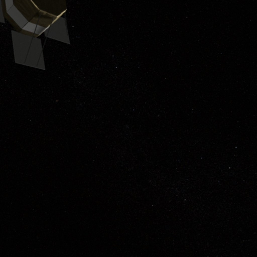</a>
  <a href="assets/examples/A_2image_00030_img/x3/A_2image_00030_img.jpg"></a>
  <a href="assets/examples/A_2image_00030_img/x4/A_2image_00030_img.jpg"></a>
</p>
<p align="center">
  <strong>B</strong><br>
  <a href="assets/examples/B_2image_00196_img/GT/B_2image_00196_img.jpg">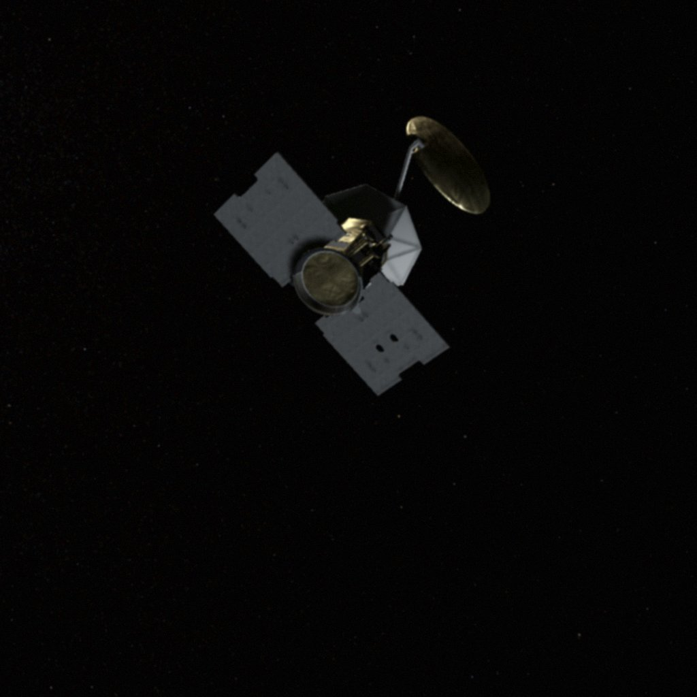</a>
  <a href="assets/examples/B_2image_00196_img/x2/B_2image_00196_img.jpg"></a>
  <a href="assets/examples/B_2image_00196_img/x3/B_2image_00196_img.jpg"></a>
  <a href="assets/examples/B_2image_00196_img/x4/B_2image_00196_img.jpg">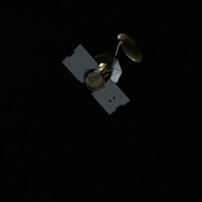</a>
</p>
<p align="center">
  <strong>C</strong><br>
  <a href="assets/examples/C_2image_00013_img/GT/C_2image_00013_img.jpg">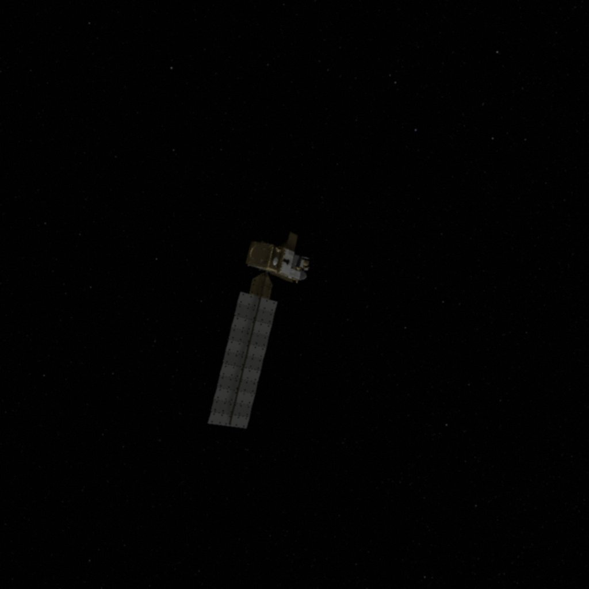</a>
  <a href="assets/examples/C_2image_00013_img/x2/C_2image_00013_img.jpg"></a>
  <a href="assets/examples/C_2image_00013_img/x3/C_2image_00013_img.jpg"></a>
  <a href="assets/examples/C_2image_00013_img/x4/C_2image_00013_img.jpg">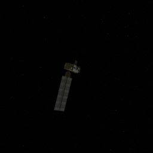</a>
</p>
<p align="center">
  <strong>D</strong><br>
  <a href="assets/examples/D_2image_00033_img/GT/D_2image_00033_img.jpg"></a>
  <a href="assets/examples/D_2image_00033_img/x2/D_2image_00033_img.jpg">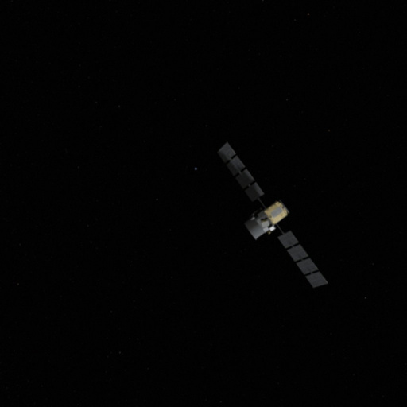</a>
  <a href="assets/examples/D_2image_00033_img/x3/D_2image_00033_img.jpg">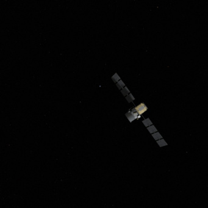</a>
  <a href="assets/examples/D_2image_00033_img/x4/D_2image_00033_img.jpg"></a>
</p>

### 双三次下采样与高斯噪声

<p align="center">
  <strong>A</strong><br>
  <a href="assets/examples/A_2image_00030_img/GT/A_2image_00030_img.jpg"></a>
  <a href="assets/examples/A_2image_00030_img/x2_gauss/A_2image_00030_img.jpg">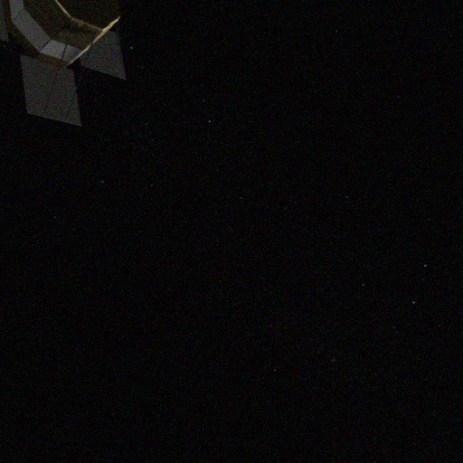</a>
  <a href="assets/examples/A_2image_00030_img/x3_gauss/A_2image_00030_img.jpg">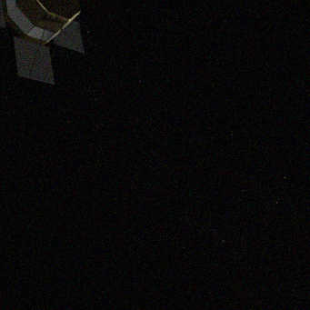</a>
  <a href="assets/examples/A_2image_00030_img/x4_gauss/A_2image_00030_img.jpg">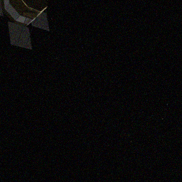</a>
</p>
<p align="center">
  <strong>B</strong><br>
  <a href="assets/examples/B_2image_00196_img/GT/B_2image_00196_img.jpg"></a>
  <a href="assets/examples/B_2image_00196_img/x2_gauss/B_2image_00196_img.jpg">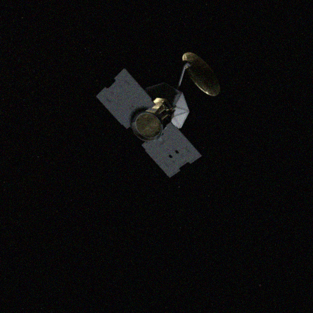</a>
  <a href="assets/examples/B_2image_00196_img/x3_gauss/B_2image_00196_img.jpg">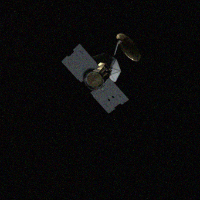</a>
  <a href="assets/examples/B_2image_00196_img/x4_gauss/B_2image_00196_img.jpg">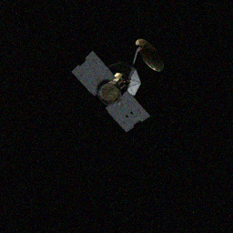</a>
</p>
<p align="center">
  <strong>C</strong><br>
  <a href="assets/examples/C_2image_00013_img/GT/C_2image_00013_img.jpg"></a>
  <a href="assets/examples/C_2image_00013_img/x2_gauss/C_2image_00013_img.jpg">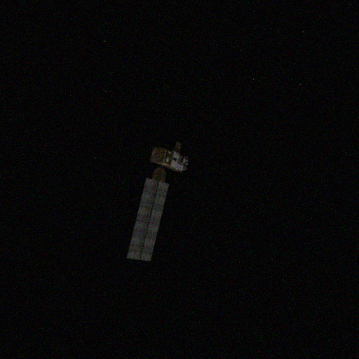</a>
  <a href="assets/examples/C_2image_00013_img/x3_gauss/C_2image_00013_img.jpg">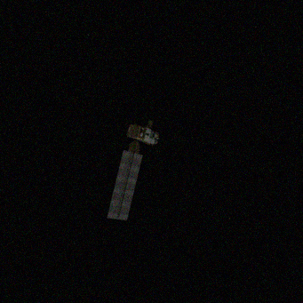</a>
  <a href="assets/examples/C_2image_00013_img/x4_gauss/C_2image_00013_img.jpg">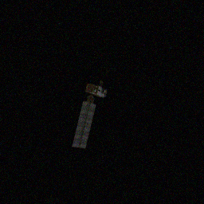</a>
</p>
<p align="center">
  <strong>D</strong><br>
  <a href="assets/examples/D_2image_00033_img/GT/D_2image_00033_img.jpg"></a>
  <a href="assets/examples/D_2image_00033_img/x2_gauss/D_2image_00033_img.jpg">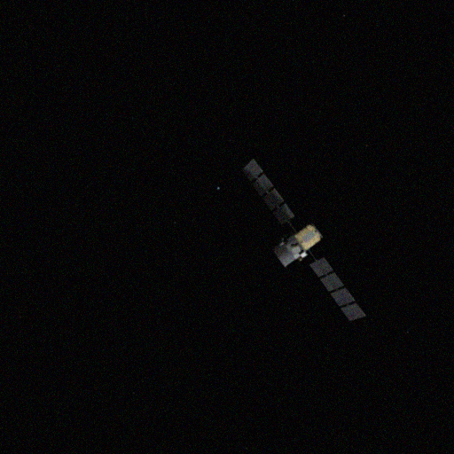</a>
  <a href="assets/examples/D_2image_00033_img/x3_gauss/D_2image_00033_img.jpg">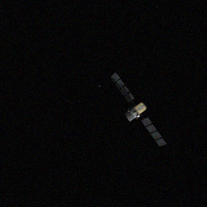</a>
  <a href="assets/examples/D_2image_00033_img/x4_gauss/D_2image_00033_img.jpg">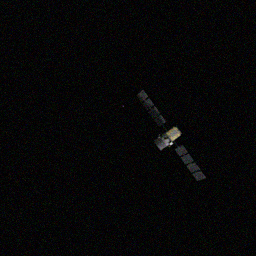</a>
</p>

## 适用范围

DSSAT-SR 可用于卫星图像超分辨率模型的监督训练、多尺度重建评价、高斯噪声
条件下的鲁棒性研究，以及结合前景掩膜的目标感知重建研究。

本数据集来源于仿真图像。在缺少真实在轨数据验证的情况下，基于该数据集获得的
性能结果不应直接等同于模型在真实空间成像条件下的性能。

## 来源、许可证与引用

DSSAT-SR 是 SPARK 2021 的衍生数据集，采用 CC BY-NC-SA 4.0 许可证进行
非商业性公开。使用者应遵守署名、非商业使用和相同方式共享的要求，并同时遵守
SPARK 2021 原始数据的使用条款。

SPARK 2021 项目主页：https://cvi2.uni.lu/spark-2021/

### 引用说明

DSSAT-SR 对 SPARK 2021 图像进行了再分发与派生处理。学术研究中引用 SPARK
2021 原始论文，可以对来源数据给予适当署名，并保证衍生数据集的来源可追溯。

```bibtex
@inproceedings{musallam2021spark,
  title     = {Spacecraft Recognition Leveraging Knowledge of Space Environment:
               Simulator, Dataset, Competition Design and Analysis},
  author    = {Musallam, Mohamed Adel and Gaudilliere, Vincent and Ghorbel, Enjie
               and Al Ismaeil, Kassem and Perez, Marcos Damian and Poucet, Michel
               and Aouada, Djamila},
  booktitle = {2021 IEEE International Conference on Image Processing Challenges},
  pages     = {11--15},
  year      = {2021},
  doi       = {10.1109/ICIPC53495.2021.9620184}
}
```

### 致谢

感谢卢森堡大学 CVI2 研究团队及其合作伙伴创建并公开 SPARK 2021 数据集。
